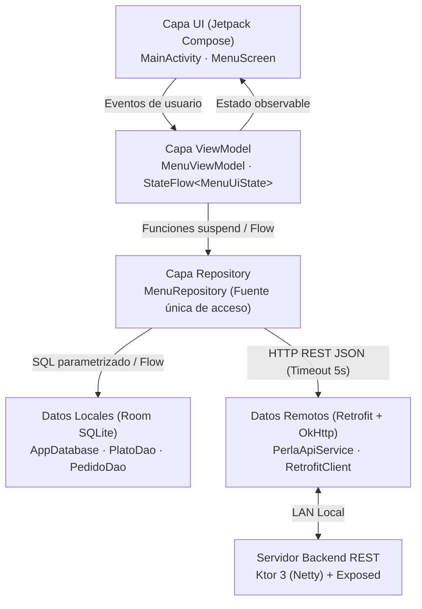

# PerlaOrder — Sistema POS & Carta Digital en Tablet (Offline-First)

**PerlaOrder** es una aplicación nativa para Android diseñada para tablets en orientación horizontal (`sensorLandscape`), creada para digitalizar el catálogo gastronómico y la operación en salón del restaurante **La Perla del Sabor**.

---

## Problema de Negocio y Solución de Ingeniería

Los restaurantes MYPE con alta rotación en horarios punta enfrentan pérdidas operativas por el uso de cartas físicas desactualizadas, errores en la toma manual de comandas y caídas frecuentes de la red Wi-Fi del local.

**Solución implementada:**
* **Arquitectura Offline-First (Prioridad Local):** La base de datos local SQLite (**Room**) actúa como fuente única de verdad (*Single Source of Truth*). La carta permanece 100% operativa en menos de 3 segundos aun sin conexión al servidor.
* **Sincronización e Integración REST:** Consumo y operaciones CRUD conectadas a un backend local en **Ktor** mediante **Retrofit + OkHttp**, con tiempos de espera controlados (5 s) y manejo reactivo de estados de carga y errores de red.
* **Precisión Financiera:** Almacenamiento de importes en céntimos (`Long`) para eliminar errores de redondeo de punto flotante (`Double`) en el cálculo de pedidos.
* **Accesibilidad y Ergonomía en Mesa:** Cumplimiento de contraste **WCAG 2.1 AA**, tipografía mínima de `18sp`, áreas táctiles de `48x48dp` y redundancia textual (`AGOTADO`) para no depender exclusivamente del color.

---

## Arquitectura del Sistema (MVVM + Flujo Unidireccional)

